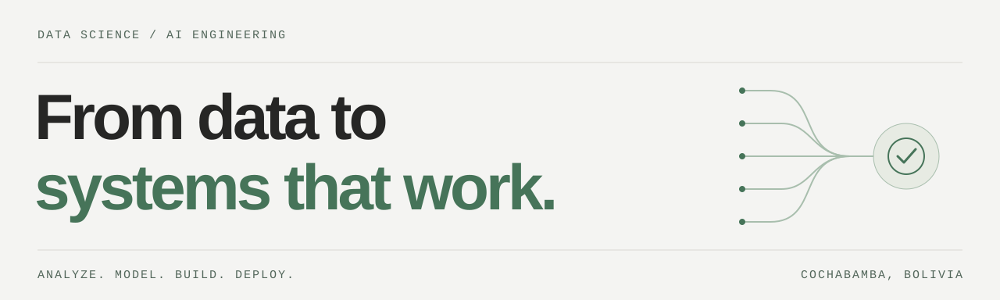

<picture>
  <source media="(prefers-color-scheme: dark)" srcset="./assets/profile-dark.svg">
  <source media="(prefers-color-scheme: light)" srcset="./assets/profile-light.svg">
  
</picture>

# Hi, I'm Freddy Villca Villegas

**AI Engineer · Data Scientist · Python Backend Developer**

Cochabamba, Bolivia 🇧🇴

I build solutions that connect data analysis, machine learning and usable AI applications — from forecasting pipelines and computer vision to APIs, voice agents and workflow automation.

**[Portfolio](https://freddxvill.github.io/)** · **[LinkedIn](https://www.linkedin.com/in/freddy-villca-villegas/)** · **[Email](mailto:fvillcavillegas@gmail.com)**

## About me

I'm an electromechanical engineer with a postgraduate degree in **Applied Statistics**. I bring that background to problems that need both careful analysis and working software.

- **Data & machine learning:** exploratory analysis, forecasting, segmentation, geospatial analysis and computer vision.
- **AI & backend:** Python APIs, LLM applications, voice agents, WhatsApp integrations and n8n workflows.
- **How I work:** start with the problem, evaluate the model, document decisions and build for everyday use.

## Selected projects

### Electricity demand forecasting · Bolivia

Daily forecasts with LightGBM, TFT and calibrated prediction intervals. **30% lower MAE** than the official CNDC forecast in a 183-day backtest.

[Code](https://github.com/freddxvill/forecast-energia-electrica-en-bolivia) · [Live app](https://demanda-energia-electrica-en-bolivia.streamlit.app/)

### Bolivian Sign Language translator

A PyTorch Transformer Encoder recognizing **58 sign classes** from 5,800 movement sequences, with MediaPipe and a PyQt5 desktop interface.

[Code & demo](https://github.com/freddxvill/Proyecto_Traductor_de_la_LSB)

### Mi Teleférico · Accessibility & expansion

Slope-aware walking accessibility and station optimization for La Paz and El Alto. Proposed **7 stations** with estimated access for **95,000 additional people**.

[Code](https://github.com/freddxvill/analisis-proyeccion-linea-teleferico-la-paz-bolivia) · [Interactive analysis](https://freddxvill.github.io/analisis-proyeccion-linea-teleferico-la-paz-bolivia/)

### Forex dashboard with an AI analyst

A Streamlit dashboard connecting Gemini, OpenAI and Claude to **11 financial data tools** for prices, indicators and news sentiment.

[Code](https://github.com/freddxvill/Forex-Dashboard-and-AI-chat-with-tools-Streamlit-App)

### ML model as an API

A movie revenue prediction API with **FastAPI**, data versioning with **DVC**, and testing and deployment workflows in **GitHub Actions**.

[Code](https://github.com/freddxvill/Deployment-ML)

## AI products

- **[Thinka AI](https://thinka-ia.com/)** — Turn a topic or PDF into interactive lessons with virtual teachers, presentations and assessments. Built with Next.js, FastAPI, LangGraph and Celery.
- **[Unative](https://landing-unative.vercel.app/)** — Practice spoken English with an AI coach powered by Gemini Live, with scores and feedback after each conversation.
- **[SincroMED](https://sincromed.com/)** — Bring patients, consultations, bookings and reminders into a multi-clinic platform built with Next.js, FastAPI and PostgreSQL.

## Toolkit

| Area | Tools I use |
| --- | --- |
| **Data & analysis** | Python, SQL, pandas, NumPy, Altair, Plotly, GeoPandas |
| **Machine learning** | scikit-learn, PyTorch, LightGBM, Transformers, MediaPipe, OpenCV |
| **AI & automation** | LangGraph, Gemini Live, LLM tool calling, n8n, MCP, WebSockets |
| **Backend & delivery** | FastAPI, PostgreSQL, Celery, Docker, GitHub Actions, DVC |
| **Applications** | Streamlit, Quarto, Next.js |

## Let's connect

I'm interested in **Data Science, Machine Learning and AI Engineering** opportunities, and in collaborations that turn data into useful products.

Have a project in mind? **[Let's talk](mailto:fvillcavillegas@gmail.com)** — or explore more of my work on my **[portfolio](https://freddxvill.github.io/)**.
